# Naqsha · نقشہ — home is where the heart is

**Everyone in the family answers alone. Qloo reads each person separately, and the words their tastes really share become the room at the centre of the house. What belongs to one person alone becomes that person's room.**

**Live app:** https://naqsha-qloo-242926648187.us-central1.run.app — open any of the four sample families and their reveal plays. No account needed.
**License:** AGPL-3.0 (open source)

*Naqsha* (نقشہ) is what families in Pakistan call a house plan; that's where it started. Anywhere in the world, a family builds a house once in a lifetime, and the plan tends to belong to whoever spoke first. Naqsha asks each person privately, finds what they have in common, and designs a house around it, built the way homes are built in that place.

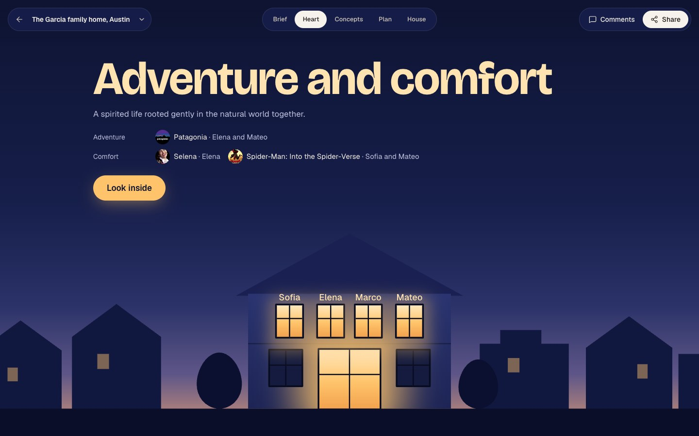

## How it works

1. **Who's home?** Name the people who will live there. Each gets a window in a house at dusk and a private link.
2. **Each person answers alone.** The film they rewatch, the song that's home, the place they miss, picked from a live search with pictures. Their window lights up when they finish.
3. **The reveal.** The windows come on one by one and the heart lights last. It shows the words their tastes share and the real favourites behind each word.
4. **The house grows around it.** What they share becomes the room at the centre. What's one person's alone becomes that person's room.
5. **Built for where you live.** Naqsha researches how homes are built in that place (lot, form, roof, walls, parking, rooms, authority) and designs to it. Lahore is one profile among the rest.
6. **Plan, walk, change.** The floor plan is checked against the city's own rules, the 3D house is written as code, and you can walk through it, pin a note on any wall and ask for a change.

## How Qloo is used

Qloo decides what the heart is. The language model never does.

| Step | Qloo API | What it gives the house |
|---|---|---|
| Choosing a favourite | `/search`, across films, artists, shows, brands, places and restaurants, with images | The exact entity each person means. A plain name search for "Selena" returned Selena Gomez in our early samples, so people pick from pictures. |
| Reading each person alone | `/v2/insights`, `filter.type=urn:tag` (Taste Analysis), once per person | That person's taste as words, across aesthetic, style, lifestyle and emotional tags. Place-only answers fall back to character, culture and scenery tags. |
| Finding the heart | the overlap of those readings, in code | The exact words in everyone's reading, else in most, else in the family's reading together. The app never claims more agreement than that (`level`). |
| The proof behind a word | Taste Analysis on each favourite alone | Which favourites carry each shared word. Explanations weren't returned for tags on this API, so we read each one separately. |
| A little of home | `urn:entity:place` with `filter.location` and a radius, signalled by the place someone's heart lives | Somewhere near the new plot that feels like it. Shown only when it differs from what's simply popular there. |
| The style brief and rooms | Taste Analysis plus destination and brand affinities | The evidence behind the concepts, the palette and each person's room. |
| "Make the lounge feel more like Istanbul" | `/search` and Taste Analysis, from the revision agent | The change is designed from Qloo's reading of Istanbul. |

The code is in [`api/app/agents/heart.py`](api/app/agents/heart.py) and [`api/app/qloo.py`](api/app/qloo.py). Gemini chooses among the shared words and names the rooms, and any word it returns that isn't in the overlap is discarded.

### What Qloo adds, honestly

We compared this with Gemini alone. A plain prompt gives you "Music, Mexico, Cities". A prompt tuned for feeling gives lovely words like "soulful", different on each run. So our claim is narrow: Qloo's words come from what people actually like, each person is read separately, and every word points to a real favourite. The list of shared words comes from data. Gemini picks which ones lead, so that choice can vary between runs, but it can't add a word that isn't there. Some results are surprising (Parasite reads as heartwarming) and we show them as they are.

In the app this is simply the Heart: families never see a data source's name or a tag id. Only favourites and a place name are sent to Qloo, never names or personal details.

## Four sample families

These families are invented; their favourites and the results are real runs of the product.

| Family | Each person read alone, what they share | Heart of the house | Their house | Same plot without their taste | Their concept |
|---|---|---|---|---|---|
| **The Maliks**, DHA Phase 6, **Lahore** (Ammi, Abbu, Sara, Ali) | *Contemporary and traditional*, all four: Abida Parveen, Muji, Khaadi, Kyoto, Coke Studio | A central courtyard veranda | 1 kanal, 46/46 LDA rules, a prayer room, a study for Abbu, a terrace for Ali | 21% | **73%** |
| **The Garcias**, Travis Heights, **Austin** (Elena, Marco, Sofia, Mateo) | *Adventure and comfort*, most of them: Patagonia, Selena, Spider-Verse | A shaded back porch with a grill | 50 × 140 ft gabled Craftsman, 34/34 City of Austin rules | 27% | **79%** |
| **The Al Mansouris**, Al Barsha, **Dubai** (Baba, Mama, Noura, Saeed) | *Elegant and inspiring*, all four: Hermès, Dune, Fairuz | A sunlit central majlis | 80 × 125 ft villa, guest majlis, maid's room, 52/52 local rules | 35% | **88%** |
| **The Parks**, Leslieville, **Toronto** (Umma, Appa, Jiwoo) | *Heartwarming*, all three: Parasite, Spirited Away | The cozy kitchen hearth | 30 × 120 ft gabled house, basement studio, laneway garage, 34/34 local rules | 55% | **91%** |

The Lahore house reached that state through the product's own revision agent: its first plan passed every LDA rule but left two upstairs rooms unreachable, and one typed request fixed it. It shows as version 2.

Each concept run also draws the same plot and brief without the family's taste, scored by a vision check against the same checklist. That shows the design follows the taste brief; it doesn't prove a family would prefer it.

## Screens

Captured from the live app with Playwright.

| | |
|---|---|
| 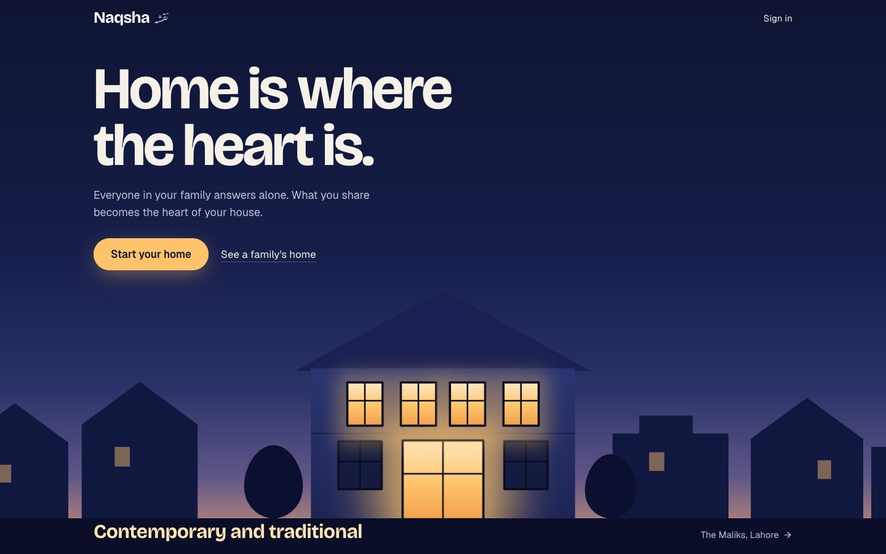 | 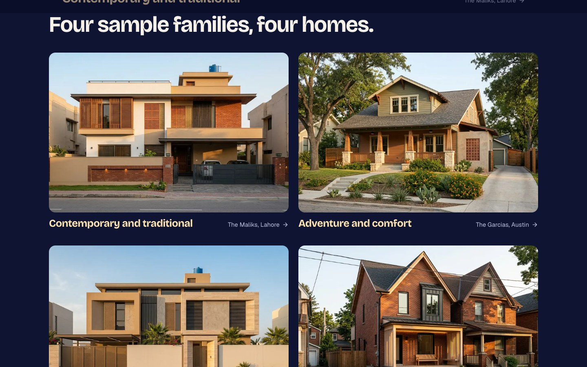 |
| **The street.** Each family's lights come on, one window per person. | **Four sample families.** One click opens a family and plays their reveal. |
| 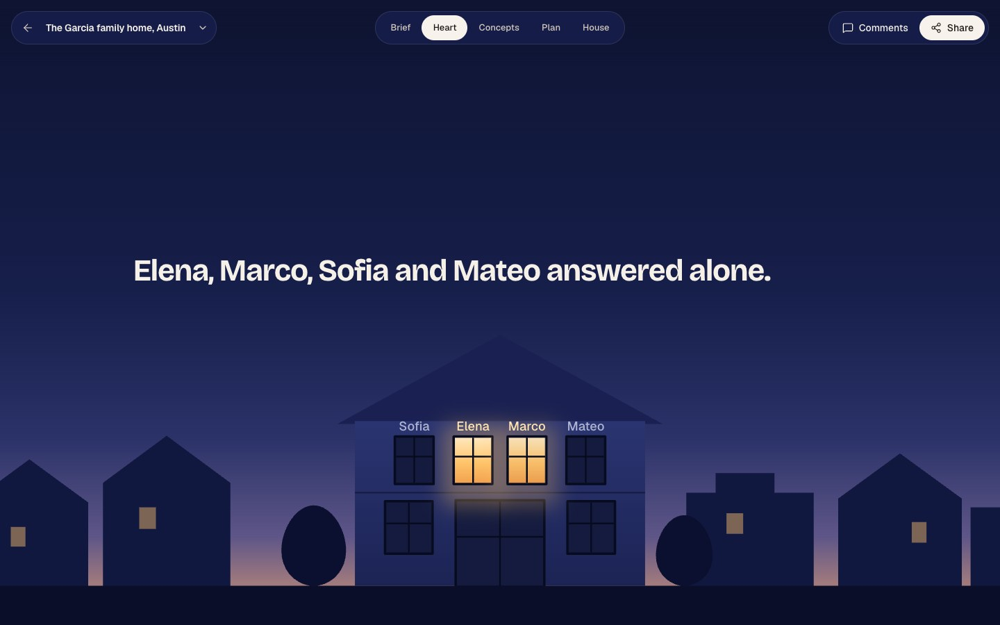 |  |
| **The reveal.** Everyone answered alone. | **The heart.** The words they share and the favourites behind them. |
| 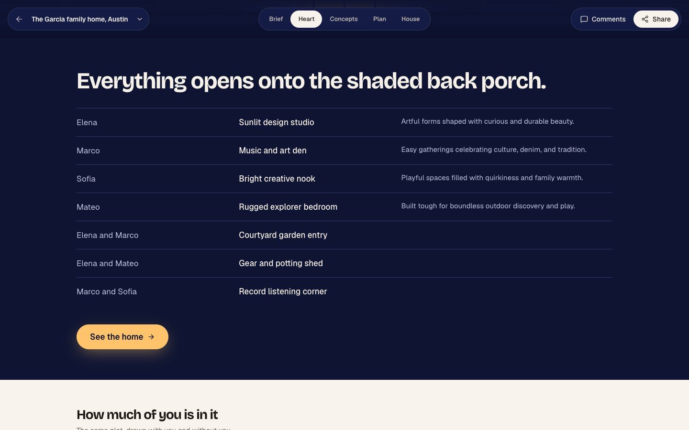 | 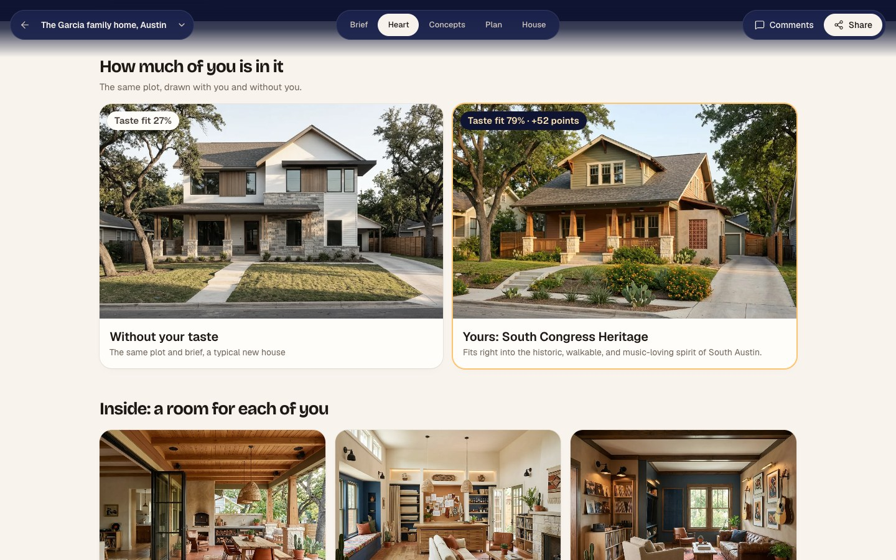 |
| **Look inside.** What's shared is the centre; what's yours is your room. | **Measured.** The same plot drawn with them and without them. |
| 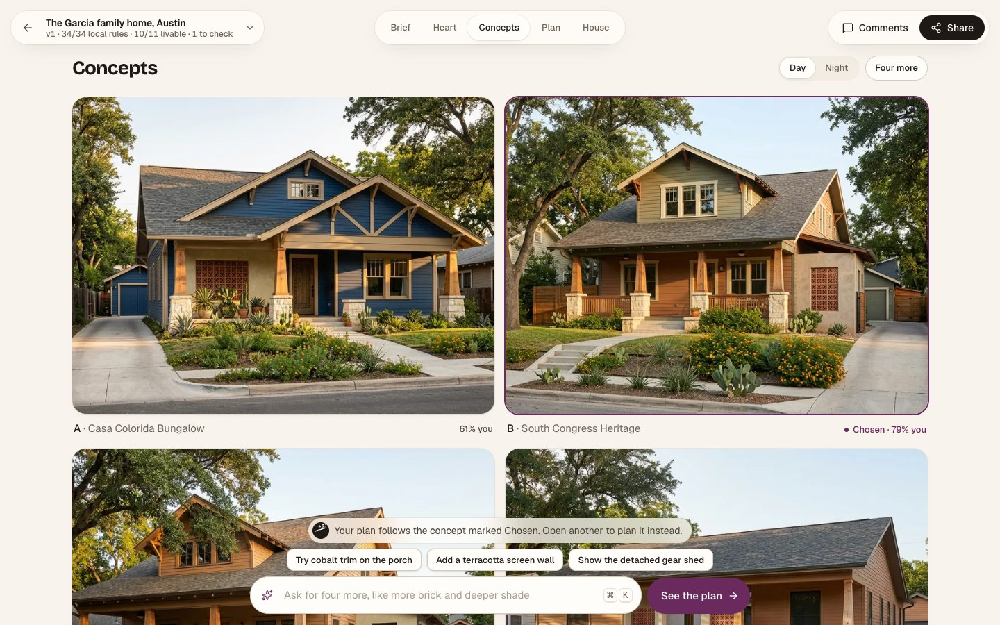 | 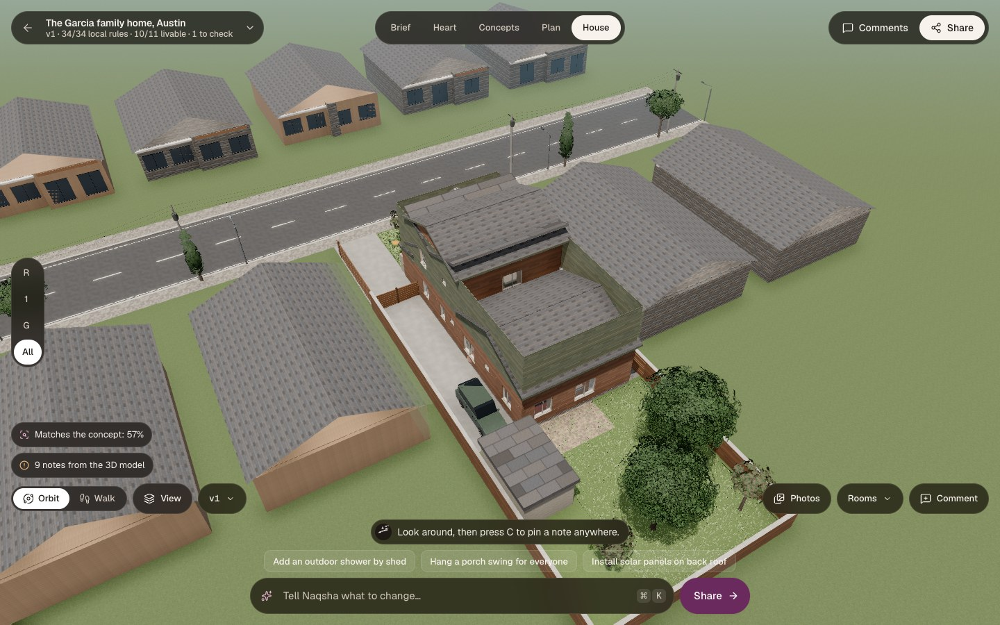 |
| **Concepts.** Each from the family's taste, each on a real Austin street. | **Walkable 3D.** Written as code, with real gables. |
| 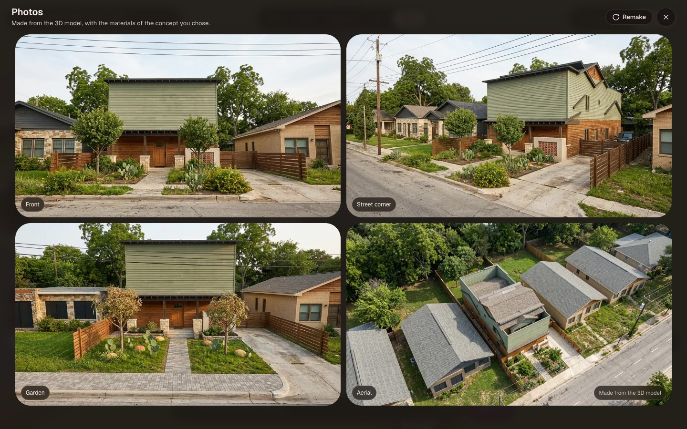 | 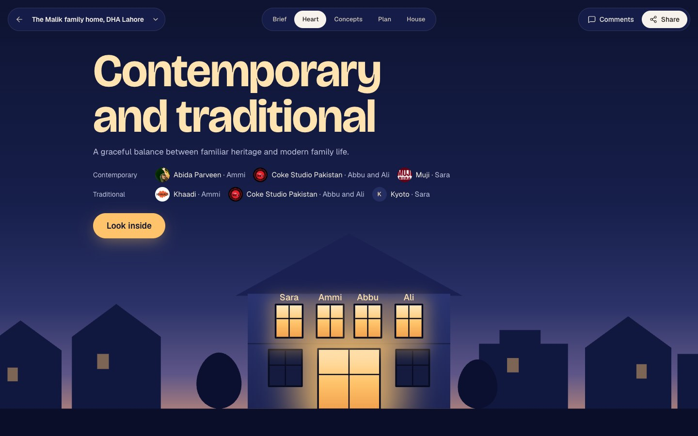 |
| **Photos.** Made from the 3D model, so every angle is the same house. | **Lahore.** Contemporary and traditional. |
| 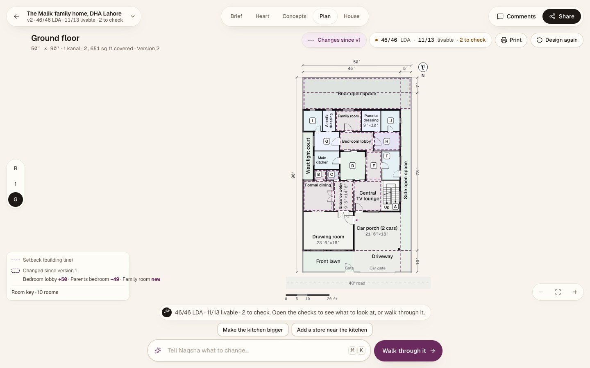 | 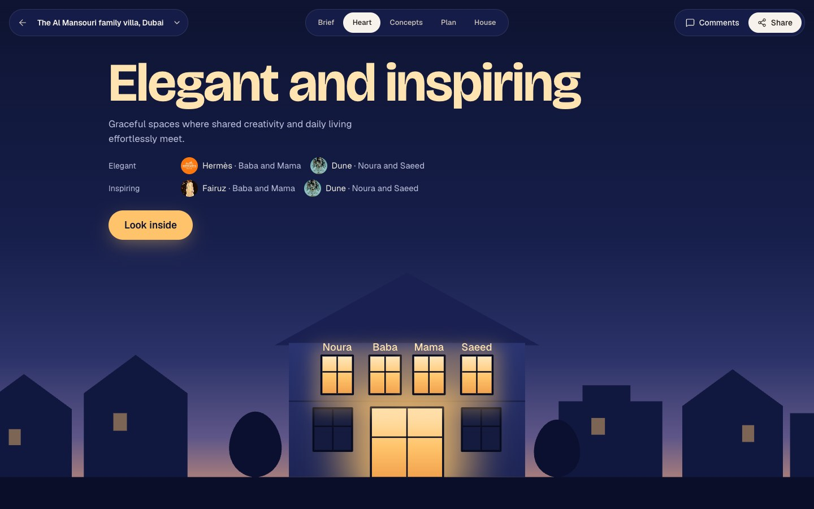 |
| **The plan.** 46/46 LDA rules, around the courtyard. | **Dubai.** Elegant and inspiring. |
| 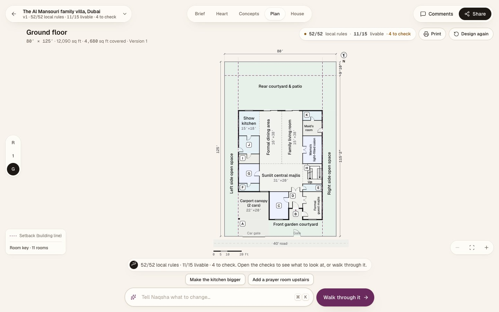 | 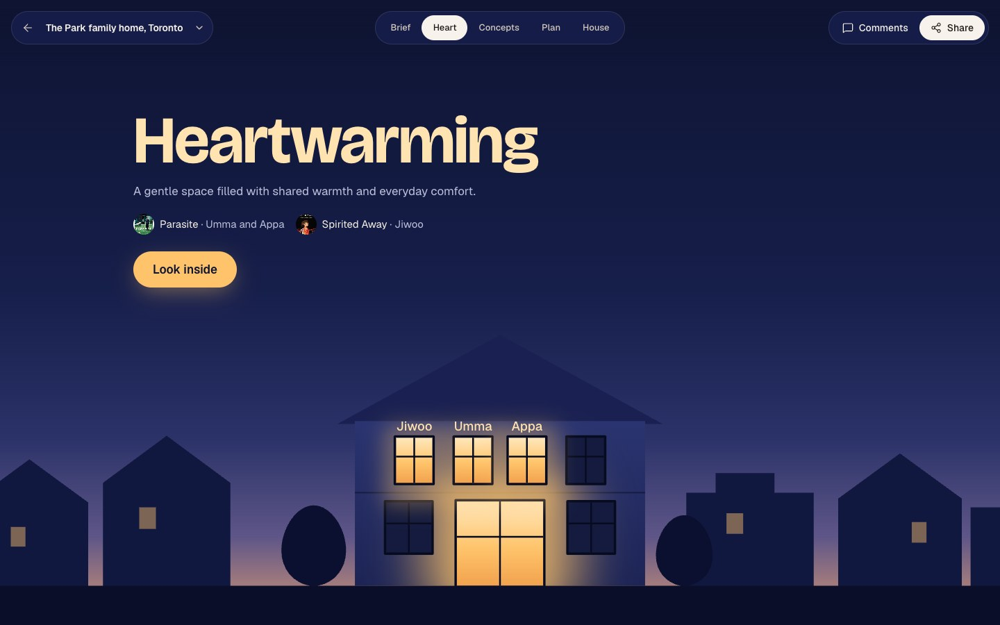 |
| **The majlis at the centre**, with a guest majlis of its own. | **Toronto.** Heartwarming. |
| 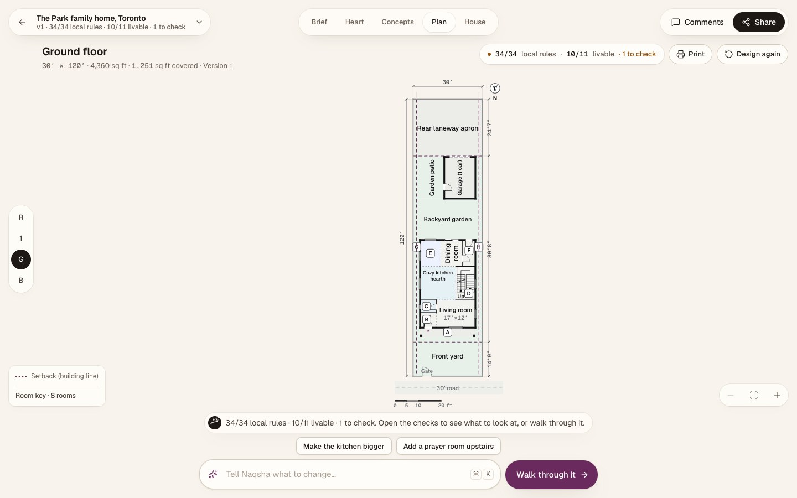 | 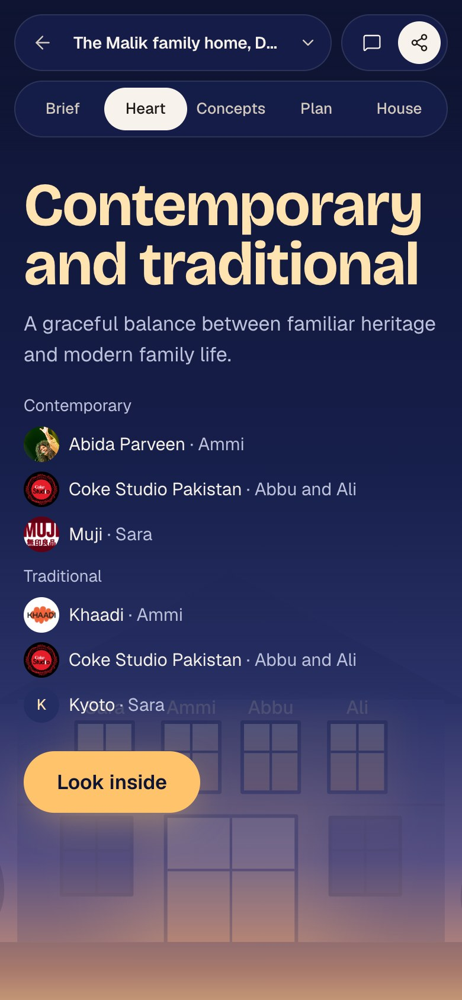 |
| **A kitchen hearth**, a basement studio, a laneway garage. | **On a phone**, where each person answers. |

## Models

| Step | Model |
|---|---|
| Setup agent, home research, the heart's wording, taste exploration (Qloo tools), rule research, quick JSON, vision reads | `gemini-3.8-flash` (Vertex AI) |
| Style brief, plans, fixer agents, 3D model, revisions | `gemini-4-argon` (Vertex AI) |
| Concepts, room pictures, photos | Gemini image models (Vertex AI) |
| Taste | Qloo taste graph (hackathon API) |
| Local rules | Tavily Search and Extract |
| Map of the plot | MapLibre GL with OpenFreeMap vector tiles (© OpenStreetMap contributors) |

## Architecture

```
React SPA (Vite, three.js, react-three-fiber)
        │  REST + Server-Sent Events
Cloud Run · FastAPI (serves the SPA and the API)
  ├─ Heart .............. each person read alone by Qloo → exact overlap → the favourites behind each word
  ├─ Home profiles ...... how homes are built in any place: Tavily + Flash, cached 90 days
  ├─ Taste agent ........ Qloo Taste Analysis / affinities → Flash explores with Qloo tools → Argon writes the style brief
  ├─ Setup agent ........ Google ADK → Gemini 3.8 Flash; tools incl. research_local_rules (Tavily)
  ├─ Architect .......... 4 drafts → rules engine → 2 fixer agents (tool calls) → self-review → design.js from the
  │                        concept's feature checklist and the family's palettes
  ├─ Rooms .............. restyle a room for one person (Qloo tags) → photoreal interior
  ├─ Reviser ............ Google ADK → Gemini 4 Argon, 10 tools incl. qloo_taste
  ├─ Rules engine ....... deterministic Python: LDA rules from the official PDFs + livable-home rules
  └─ Firestore / Cloud Storage
```

Code map: `api/app/qloo.py` (Qloo client), `api/app/agents/heart.py` (the heart), `api/app/agents/homes.py` (home profiles), `api/app/agents/taste.py` (taste agent, room styling), `api/app/agents/` (architect, fixer, research, importer, views, setup, reviser), `api/app/compliance/` (rules engine), `contracts/` (plan schema, House SDK), `api/app/agents/locality.py` (the neighbourhood read), `web/src/app/taste/` (the Taste view and the neighbourhood map), `web/src/` (app, 3D engine, viewer).

## Run locally

Prerequisites: Node 22, Python 3.13, `uv`, a Qloo hackathon API key, a Tavily API key, and a Google Cloud project with Vertex AI, Firestore and Cloud Storage.

```bash
cp .env.example .env              # fill in GOOGLE_CLOUD_PROJECT, TAVILY_API_KEY
zsh scripts/set-qloo-key.sh       # asks for the Qloo key without echoing it
cd api && uv sync && cd ..
zsh scripts/dev-api.sh            # API on :8080
cd web && npm ci && npx vite      # app on :5173
```

To work on the UI with no backend: `cd web && VITE_MOCK=1 npx vite`. Tests: `cd api && uv run pytest`, and the Playwright suite in `e2e/`.

Deploy: `scripts/push-secrets.sh` copies the Qloo and Tavily keys into Secret Manager; `scripts/deploy.sh` deploys to Cloud Run.

## Built during the hackathon

Naqsha was started in October 2026. For the Qloo Agentic Hackathon we built the Qloo client, the heart (private links, reading each person alone, the overlap, the proof behind each word, the reveal), the taste agent and style brief, rooms that follow each person, local home profiles that replaced the Lahore defaults, pitched roofs with cross-gables in the 3D engine, and the dusk interface. The design system is in [DESIGN.md](DESIGN.md).

## Disclaimer

Naqsha produces concept designs and a regulation pre-check. Building plans must still be signed by a registered architect, and researched rule packs must be confirmed with the authority. Qloo results describe aggregate taste affinities, not facts about any person.

## License

Copyright © 2026 Pivot Analytix (Abdullah Moazzam, Saad Wali Muhammad Joiya, Usama Bin Maalik). Licensed under the GNU Affero General Public License v3.0; see [LICENSE](LICENSE).
