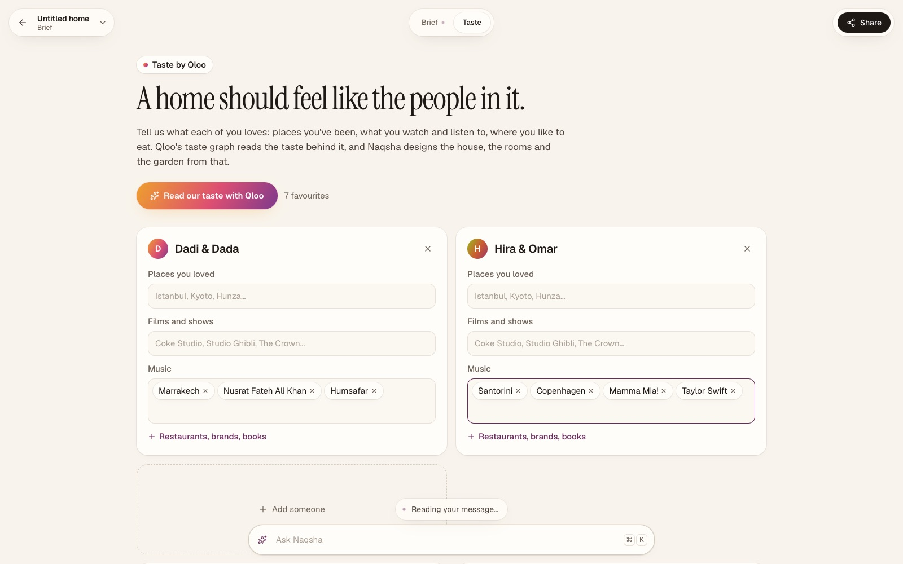
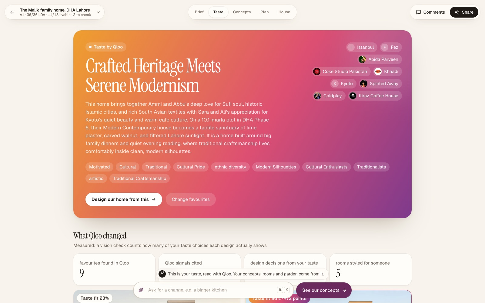
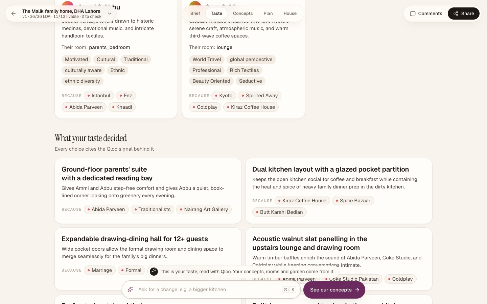
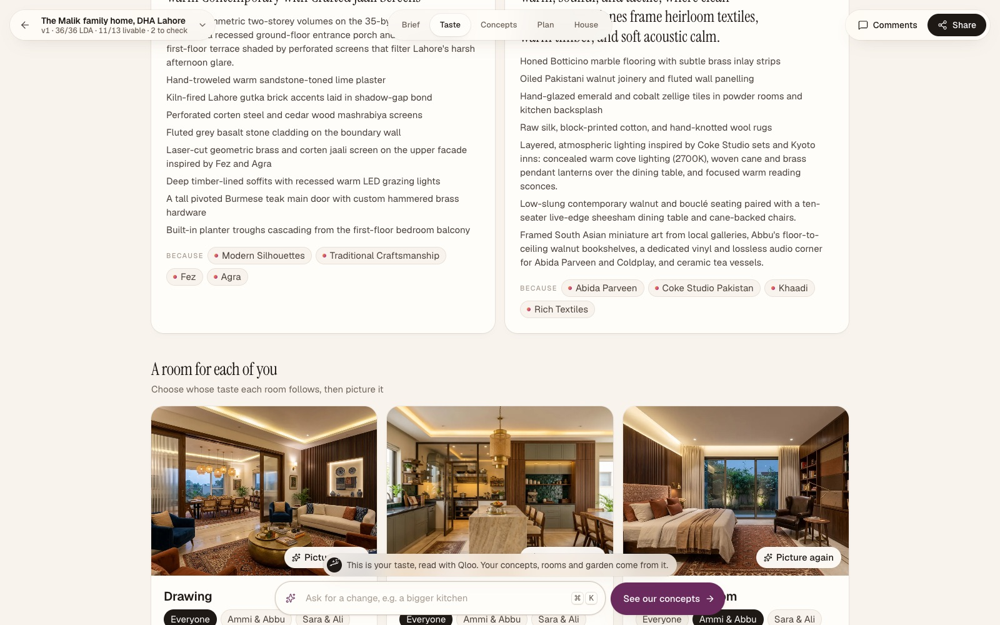
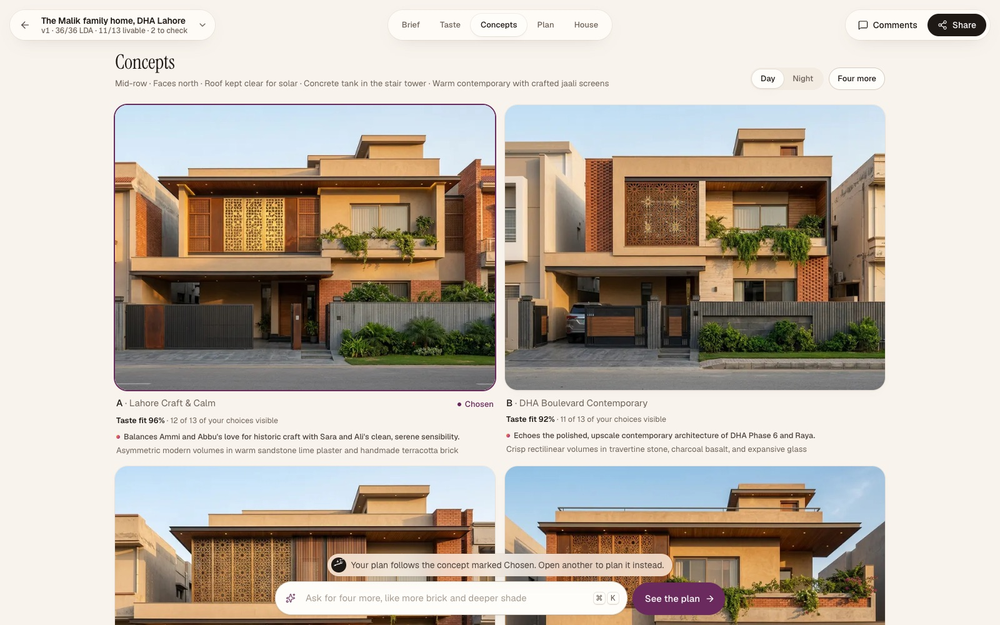
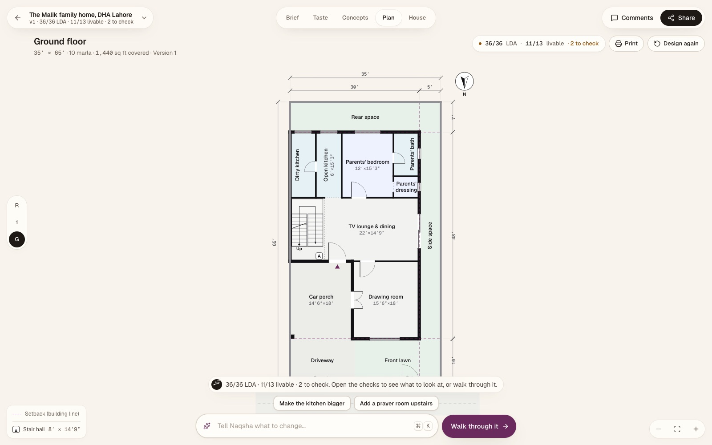
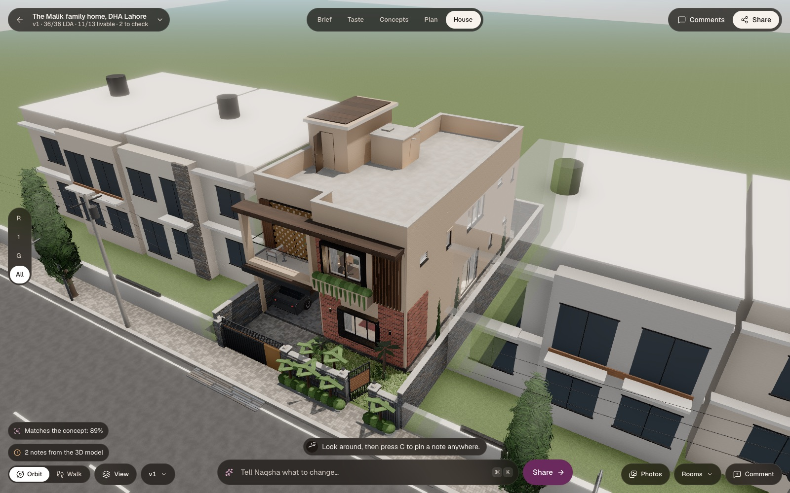
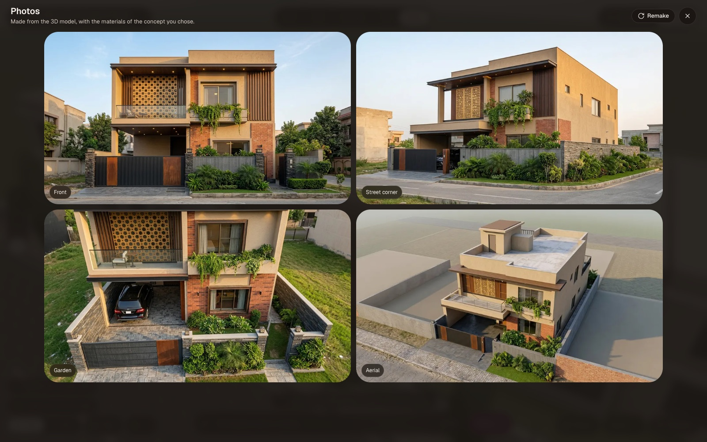
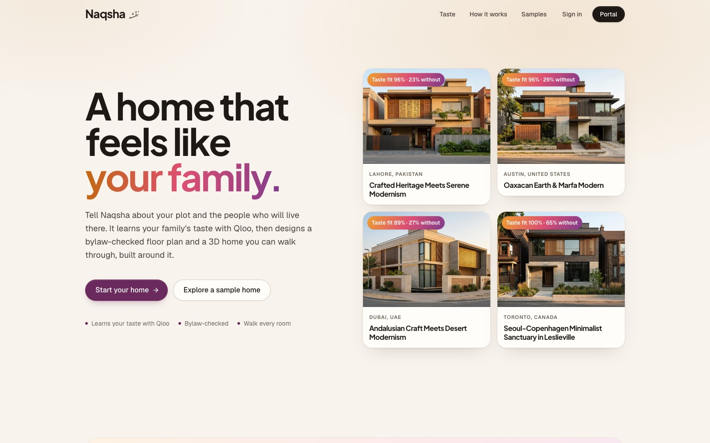

# Naqsha · نقشہ — a home that feels like your family

**Each person in the family shares what they love: places they've been, what they watch and listen to, where they like to eat. Naqsha reads the taste behind it with Qloo's taste graph and designs the house around it: a floor plan checked against the city's building rules, a 3D home you can walk through, a room for each person, and photographs from every angle.**

**Live app:** https://naqsha-qloo-242926648187.us-central1.run.app — open the sample home, or start your own. No account needed.
**License:** AGPL-3.0 (open source)

*Naqsha* (نقشہ) is what families in Pakistan call a house plan. A family builds a house once in a lifetime, and in most places it still starts from a contractor's sketch and a handful of stock styles. Two families with nothing in common end up with the same house. Naqsha starts from the people instead.

## Why Qloo

Language models can guess that someone who loves Kyoto might like timber and calm rooms. They can't tell you what a particular family has in common across Abida Parveen, Coke Studio, Istanbul, Spirited Away and their favourite café, or what the neighbourhood they're building in actually feels like. Qloo's taste graph can, with evidence. Naqsha uses it at every step:

| What Naqsha asks Qloo | Qloo API | What the design gets from it |
|---|---|---|
| Find each favourite | `/search` | The family's films, artists, shows, places, restaurants and brands as Qloo entities (with their own tags) |
| The taste behind each person's favourites, and the family's together | `/v2/insights`, `filter.type=urn:tag` (Taste Analysis), aesthetic property, personal style, cultural relevance, lifestyle and emotional tone tags, diversified by type, with explainability | "Traditional Craftsmanship", "Modern Silhouettes", "Rich Textiles", "Refined Elegance"…, each tied to the favourites that point to it |
| Destinations and brands people with that taste love | `/v2/insights`, `urn:entity:destination` / `urn:entity:brand` (fashion and retail) | Architectural references and textile language beyond what the family named |
| How the neighbourhood feels | `/v2/insights`, `urn:entity:place` with `filter.location.query` | The area's character, read from the ambience, decor and setting tags of its places |
| Places there that suit the family | the same, with `signal.interests.entities` and place-category tags | Galleries, makers and shops for the interiors |
| "Make the lounge feel more like Istanbul" | `/search` + Taste Analysis, from the revision agent | The change is designed from Qloo's reading of Istanbul |

## Measured impact

Naqsha measures how much of the family's taste each design shows. A vision check scores every picture
against the family's taste checklist (the materials, colours, details and decisions in their style brief, each tied to Qloo
evidence), and every concept run also draws the same plot and brief **without** the taste, scored the same way.

| The Malik family, DHA Phase 6, Lahore (the sample home) | Taste fit |
|---|---|
| The same brief without their taste | 23% |
| Their concept, "Lahore Craft & Calm" | **96%** (+73 points) |
| The photograph of the built 3D house | 77% (8 of 13 choices judged from the front) |

Two families, two different houses: the Malik family (Istanbul, Fez, Abida Parveen, Coke Studio; Kyoto, Spirited Away,
Coldplay) got "Crafted Heritage Meets Serene Modernism"; the Siddiqui family in Karachi (Marrakech, Nusrat Fateh Ali Khan;
Santorini, Copenhagen, IKEA; Taylor Swift, Friends) got "Aegean Light Meets Moroccan Craft". A family who shares no
favourites still gets a personal house: in F-11 Islamabad the agent read the area's taste from the places people love there
and designed "Margalla Stone and Modern Craft".

Even Naqsha's one-tap suggestions come from Qloo ("Add Marrakech brass screens for privacy", "Try Santorini white arches on
balconies"), each with its evidence.

Only favourites and a place name are sent to Qloo, never names or personal data. Qloo results are cached privately on the server and never stored in this repository.

## What it does

1. **Brief.** One message is enough: *"10 marla in DHA Phase 6 Lahore, four bedrooms, parents downstairs."* A setup agent (Google ADK, Gemini) records the brief and asks only what's missing. Or **upload a drawing** of a plan, and a vision model reads it room by room.
2. **Taste.** Each person adds a few favourites. The **taste agent** gathers each person's taste and the family's from Qloo, explores further with Qloo tools where it matters (Gemini 3.8 Flash: a destination worth reading, local makers), and Gemini 4 Argon writes the family's **style brief**: exterior, interiors, a room for each person, the garden, four concept directions and the key decisions. Every choice carries "because" chips that show the Qloo evidence behind it.
3. **Measured, every time.** Each concept shows its taste fit, next to the same brief drawn without the family's taste; the built house is scored from its photograph. No favourites? The locality's taste is read from Qloo first, so no design is generic.
4. **A room for each of you.** Each room follows one person's taste, or everyone's. Switch whose taste a room follows and it is restyled from their Qloo tags, then pictured as a photoreal interior.
5. **Concepts.** Four exteriors, one per taste direction: the family's shared taste, the parents', a fit with the neighbourhood, and a bolder direction from an adjacent taste. Each says why it suits them.
6. **Rules for the city.** Lahore's LDA rules ship hand-verified; for any other city the agent researches the authority's bylaws with **Tavily** and writes a cited rule pack.
7. **Plan.** The architect drafts four plans in parallel from proven layouts; a deterministic rules engine scores them against the bylaws and livable-home rules, and two tool-using fixer agents repair the best ones edit by edit until every check passes.
8. **House.** The 3D model is written as code against our House SDK (three.js), built from the chosen concept feature by feature and furnished from the family's palettes and materials, room by room. A vision check compares it with the concept and rebuilds what's missing. Photos from the road, the corner, the garden and the air are made from the model.
9. **Walk, comment, revise.** Walk through in first person, pin a note on any wall, share a link so relatives can comment from their phones. The revision agent applies the notes in the family's taste, re-checks the rules and answers each one.

## Screens

Captured from the live app with Playwright.

| | |
|---|---|
|  |  |
| **Taste.** Each person adds a few favourites as chips. | **Their style.** Qloo's reading of the family, and the favourites behind it. |
|  |  |
| **What Qloo changed.** The same brief without their taste scores 23%; theirs, 96%. | **Decisions.** Every choice cites the Qloo signals behind it. |
|  |  |
| **Rooms.** Each follows one person's taste; switch it and picture it. | **Concepts.** One per taste direction, each with its measured fit. |
|  |  |
| **Plan.** Every bylaw check passes. | **House.** Built in 3D from the concept and the family's palettes. |
|  |  |
| **Photos.** Made from the 3D model, from four angles. | **Start.** Open the sample home, or start your own. |

## Models

| Step | Model |
|---|---|
| Setup agent, taste exploration (Qloo tools), rule research, quick JSON, vision reads | `gemini-3.8-flash` (Vertex AI) |
| Style brief, plans, fixer agents, 3D model, revisions | `gemini-4-argon` (Vertex AI) |
| Concepts, room pictures, photos | Gemini image models (Vertex AI) |
| Taste | Qloo taste graph (hackathon API) |
| Local rules | Tavily Search and Extract |

## Architecture

```
React SPA (Vite, three.js, react-three-fiber)
        │  REST + Server-Sent Events
Cloud Run · FastAPI (serves the SPA and the API)
  ├─ Taste agent ........ Qloo search / Taste Analysis / affinities / locality → Flash explores with Qloo tools → Argon writes the style brief
  ├─ Setup agent ........ Google ADK → Gemini 3.8 Flash; tools incl. research_local_rules (Tavily)
  ├─ Architect .......... 4 drafts → rules engine → 2 fixer agents (tool calls) → self-review → design.js from the
  │                        concept's feature checklist and the family's palettes
  ├─ Rooms .............. restyle a room for one person (Qloo tags) → photoreal interior
  ├─ Reviser ............ Google ADK → Gemini 4 Argon, 10 tools incl. qloo_taste
  ├─ Rules engine ....... deterministic Python: LDA rules from the official PDFs + livable-home rules
  └─ Firestore / Cloud Storage
```

Code map: `api/app/qloo.py` (Qloo client), `api/app/agents/taste.py` (taste agent, room styling), `api/app/agents/` (architect, fixer, research, importer, views, setup, reviser), `api/app/compliance/` (rules engine), `contracts/` (plan schema, House SDK), `web/src/app/taste/` (the Taste view), `web/src/` (app, 3D engine, viewer).

## Run locally

Prerequisites: Node 22, Python 3.13, `uv`, a Qloo hackathon API key, a Tavily API key, and a Google Cloud project with Vertex AI, Firestore and Cloud Storage.

```bash
cp .env.example .env              # fill in GOOGLE_CLOUD_PROJECT, TAVILY_API_KEY
zsh scripts/set-qloo-key.sh       # asks for the Qloo key without echoing it
cd api && uv sync && cd ..
zsh scripts/dev-api.sh            # API on :8080
cd web && npm ci && npx vite      # app on :5173
```

To work on the UI with no backend: `cd web && VITE_MOCK=1 npx vite`. Tests: `cd api && uv run pytest`, and the Playwright suite in `e2e/`.

Deploy: `scripts/push-secrets.sh` copies the Qloo and Tavily keys into Secret Manager; `scripts/deploy.sh` deploys to Cloud Run.

## Built during the hackathon

Naqsha was started in October 2026. For the Qloo Agentic Hackathon we added the taste layer: the Qloo client, the taste agent and its style brief, rooms that follow each person's taste, concepts from taste directions, the family's palettes in the 3D build and revisions, the Taste view, and a redesigned interface.

## Disclaimer

Naqsha produces concept designs and a regulation pre-check. Building plans must still be signed by a registered architect, and researched rule packs must be confirmed with the authority. Qloo results describe aggregate taste affinities, not facts about any person.

## License

Copyright © 2026 Pivot Analytix (Abdullah Moazzam, Saad Wali Muhammad Joiya, Usama Bin Maalik). Licensed under the GNU Affero General Public License v3.0; see [LICENSE](LICENSE).
